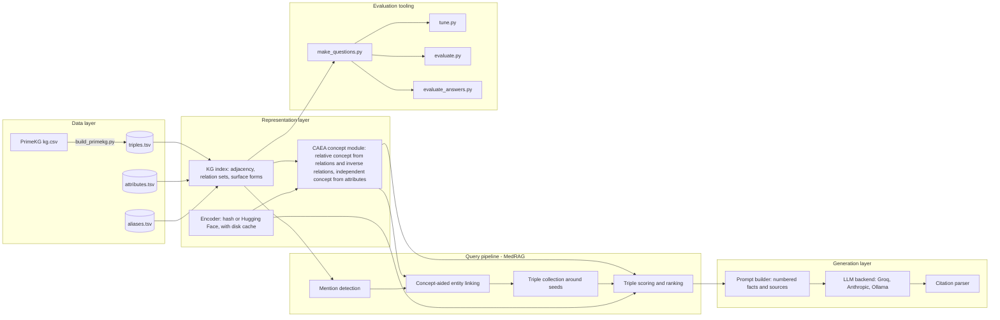
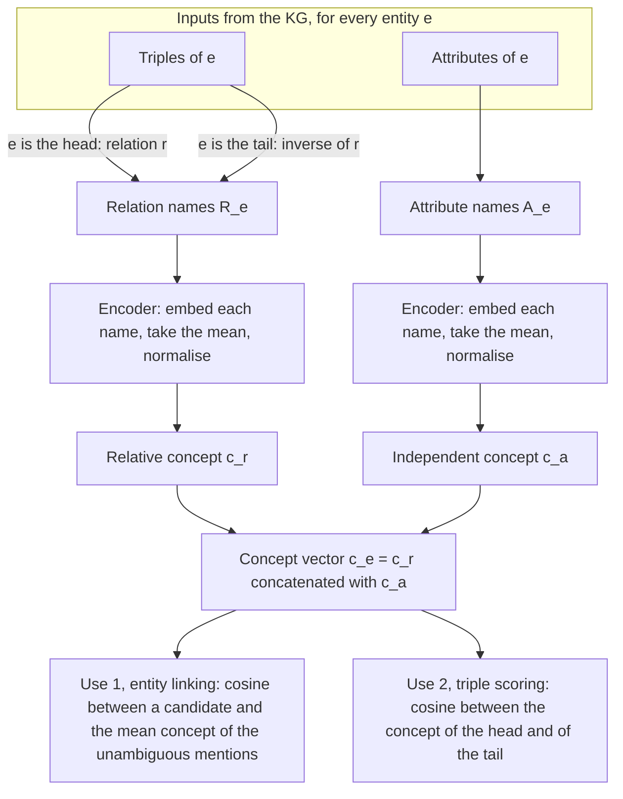
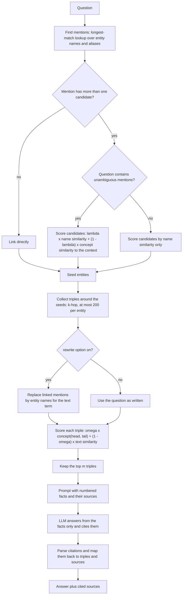
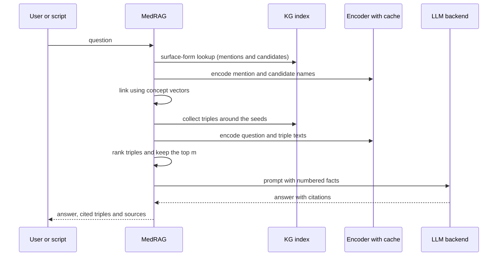
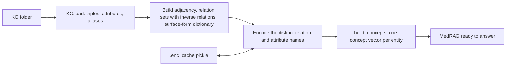
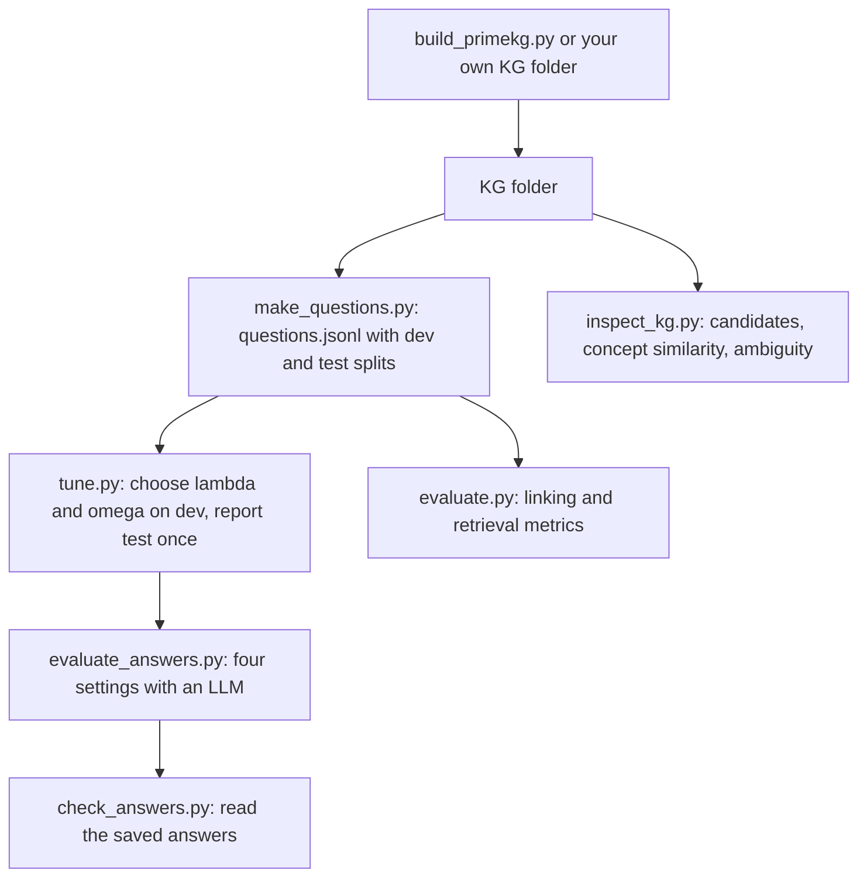

# Concept-Aware Retrieval for Medical KG-RAG

A training-free retrieval pipeline for question answering over a medical knowledge graph (KG).
It transfers the central idea of **CAEA** (Concept-Aware Entity Alignment) — *the concept of an entity can be
derived from the relations and attributes it has, without any ontology* — to a KG-RAG system, where concept
vectors are used for

1. **entity linking** – deciding which KG entity an ambiguous mention in a question refers to
   (e.g. *MS* = multiple sclerosis, or morphine sulfate), and
2. **triple retrieval** – choosing which facts from the KG are passed to a language model.

The language model answers **only from the retrieved triples** and cites each fact it uses, together with the
fact's source. No neural network is trained; the only models used are a text encoder and (optionally) an LLM.

## Core idea: CAEA concept representation

**CAEA** (Concept-Aware Entity Alignment network; Wu et al., IEEE Transactions on Industrial Informatics, 2025 —
see [References](#references)) aligns entities across two knowledge graphs. Its central observation is that
*entities of the same concept (class) have similar relations and attributes*, so the concept of an entity can be
derived from them **without an external ontology or explicit type links**:

* the **relative concept** of an entity is built from its relations — an inverse relation is added for every
  triple, so that tail entities also receive relational evidence;
* the **independent concept** is built from its attributes;
* the two are concatenated into one concept vector `c_e = c_e^r ‖ c_e^a`.

CAEA uses these vectors to separate entities that share a name (its example: a *Firewall* that is a
network-security system in one graph and a vehicle part in another) and to decide which neighbours matter.

**This project takes that concept representation as its core and applies it, without training, to medical
KG-RAG.** The correspondence is:

| CAEA | This project |
|---|---|
| Relative concept from relations, including inverse relations | `build_concepts`: mean encoder vector of an entity's relation names; the tail side of a triple gets `inverse of <relation>` |
| Independent concept from attributes | mean encoder vector of the entity's attribute names (`attributes.tsv`) |
| Concept vector `c = c^r ‖ c^a` | the same concatenation (`--concept rel`, `attr` or `both`) |
| No external ontology | the pipeline reads no type labels; concepts come from relation and attribute names only |
| Concepts distinguish same-name entities | **concept-aided entity linking**: `s(m, e) = λ · name_sim + (1 − λ) · cos(c_e, c̄_q)` — e.g. *MS* becomes multiple sclerosis or morphine depending on the other entities in the question |
| Concepts indicate which neighbours matter | the concept term `ω · cos(c_h, c_t)` in **triple scoring** |
| Learned embeddings, graph-attention GCN, margin loss on seed alignments | not part of this project: names are encoded by a pre-trained text encoder and nothing is trained |
| Task: align entities between two KGs | Task: answer questions over one KG, with linked entities and ranked triples as the retrieval step |

See it working on the demo KG:

```bash
python inspect_kg.py demo_data "ms"      # two candidates (a disease and a drug) and the cosine between their concept vectors
python evaluate.py                       # linking accuracy: name only vs name + concept
```

---

## 1. System architecture

The system has five layers. Data is read once into an in-memory index; every question then flows through the
query pipeline; the generation layer is optional and swappable.



| Layer | Responsibility | Implemented in |
|---|---|---|
| Data | Store the KG as plain TSV files; convert external KGs | `triples.tsv`, `attributes.tsv`, `aliases.tsv`, `build_primekg.py` |
| Representation | In-memory index of the KG, text encoders, concept vectors | `KG`, `HashEncoder`, `HFEncoder`, `CachedEncoder`, `build_concepts` in `medrag.py` |
| Query pipeline | Mention detection, linking, triple collection, scoring | `MedRAG` in `medrag.py` |
| Generation | Prompt with numbered, source-tagged facts; LLM call; citation parsing | `build_prompt`, `generate`, `parse_citations`, `answer_question` in `medrag.py` |
| Evaluation | Question generation, tuning, metrics | `make_questions.py`, `tune.py`, `evaluate.py`, `evaluate_answers.py`, `check_answers.py`, `inspect_kg.py` |

### 1.1 How the CAEA concept module works inside the architecture

The concept module is the CAEA idea and the only component that decides *what kind of thing* an entity is. It is
built once from the KG, and its output is consumed in two places of the query pipeline.



| Step | What happens | Where in the code |
|---|---|---|
| 1. Collect names | Relations of `e` (tail side as `inverse of <relation>`) and attribute names of `e` | `KG.__init__` (`rels`, `attrs`) |
| 2. Encode | Each distinct name is embedded once by the encoder and cached | `CachedEncoder` |
| 3. Aggregate | Mean over the relation names → `c_r`; mean over the attribute names → `c_a`; both normalised | `build_concepts` |
| 4. Combine | `c_e = [c_r ‖ c_a]` | `build_concepts` |
| 5a. Use in linking | The mean concept vector of the unambiguous mentions in the question is compared with each candidate | `MedRAG.link` |
| 5b. Use in scoring | `cos(c_head, c_tail)` is one term of the triple score | `MedRAG.score_triples` |

**Worked example** (`demo_data`, hash encoder, `--concept both`). The mention *MS* has two candidates:

| Entity | Relation names (what its concept is built from) |
|---|---|
| `Morphine_sulfate` | has side effect, interacts with, is a |
| `Multiple_sclerosis` | affects organ, has symptom, inverse of treats, is a |

The other entities in the question supply the context:

| Question | Unambiguous context mention | Concept cosine to `Morphine_sulfate` | to `Multiple_sclerosis` | MS is linked to |
|---|---|---|---|---|
| "Which drug interacts with **MS**, like **codeine** does?" | `Codeine` (has side effect, inverse of interacts with, is a) | **0.96** | 0.41 | `Morphine_sulfate` |
| "Which drugs treat **MS**, unlike **rheumatoid arthritis**?" | `Rheumatoid_arthritis` (affects organ, has symptom, inverse of treats, is a) | 0.36 | **1.00** | `Multiple_sclerosis` |

The same abbreviation resolves to different entities because the entities around it have similar relations,
which is the CAEA premise. No type labels or ontology are involved. You can reproduce the numbers with
`python inspect_kg.py demo_data "ms"` and the two commands in [Quick start](#9-installation-and-quick-start).

---

## 2. System flow charts

### 2.1 Query-time flow (one question)



### 2.2 Component interaction



### 2.3 Start-up flow (index and concept vectors)



### 2.4 Experiment workflow



---

## 3. Tech stack

| Area | Technology | Use in this project |
|---|---|---|
| Language | Python 3.9+ (developed with 3.12–3.13) | Entire code base (about 1,200 lines) |
| Numerics | NumPy | Vector math, cosine similarity, concept matrix |
| Text encoders | PyTorch, Hugging Face Transformers (`AutoTokenizer`, `AutoModel`) | Mean-pooled sentence/name embeddings; runs on CUDA, Apple MPS or CPU |
| Offline encoder | Pure Python + NumPy (`zlib.crc32` hashing of character 3- and 4-grams, 512 dims) | Tests and quick runs without downloads |
| Caching | `pickle`, `atexit` | On-disk embedding cache per model in `.enc_cache/` |
| LLM backends | Groq (OpenAI-compatible REST via `urllib`), Anthropic SDK, Ollama REST | Optional answer generation |
| Data formats | TSV (KG), JSONL (questions), JSON (results), CSV (PrimeKG input) | Storage and exchange |
| External KG | PrimeKG (public precision-medicine KG) | Real-world evaluation data |
| Standard library | `argparse`, `json`, `re`, `csv`, `random`, `collections`, `itertools`, `os` | CLI, parsing, sampling |
| Infrastructure | none — no database, server or GPU requirement | Runs as command-line scripts |

---

## 4. Components

### 4.1 `medrag.py` (core library and CLI)

| Name | Kind | Role |
|---|---|---|
| `HashEncoder` | class | Offline encoder: hashed character n-grams, L2-normalised |
| `HFEncoder` | class | Hugging Face encoder: batched inference (64), max 64 tokens, mean pooling over the attention mask, L2-normalised |
| `CachedEncoder` | class | Wraps an encoder; encodes each distinct string once; persists to disk |
| `get_encoder(name)` | function | `hash` → `HashEncoder`; anything else → `HFEncoder` with disk cache |
| `KG` | class | In-memory index of the KG (see section 5.1); `KG.load(folder)` reads the three files |
| `build_concepts(kg, enc, mode)` | function | Returns the matrix of concept vectors, one row per entity |
| `MedRAG` | class | `find_mentions`, `link`, `khop_triples`, `score_triples`, `rewrite_question`, `retrieve` |
| `build_prompt` | function | Grounded prompt with numbered, source-tagged facts (or the no-retrieval prompt) |
| `parse_citations` | function | Maps `[n]` markers in an answer back to triples and sources |
| `answer_question` | function | Retrieval + prompt + generation + citation parsing for one question |
| `generate` | function | LLM backends: `none`, `extractive`, `ollama`, `groq`, `anthropic` |

### 4.2 Scripts

| Script | Input | Output |
|---|---|---|
| `medrag.py` | KG folder, question | links, top triples, answer with cited sources |
| `evaluate.py` | KG folder, `questions.jsonl` | linking, retrieval and ablation metrics → JSON |
| `tune.py` | KG folder, `questions.jsonl` | best λ, ω on dev; test metrics → JSON |
| `evaluate_answers.py` | KG folder, `questions.jsonl`, LLM | answer metrics for four settings → `answers.json` |
| `check_answers.py` | `answers.json` | per-question answers, links, context, citations |
| `inspect_kg.py` | KG folder | candidates and concept similarity; ambiguity list; per-relation concept cosine |
| `build_primekg.py` | PrimeKG `kg.csv` | KG folder (`triples.tsv`, `aliases.tsv`, `types.tsv`) |
| `make_questions.py` | KG folder | `questions.jsonl` (plain or ambiguous-mention questions) |

---

## 5. Data model and file formats

### 5.1 In-memory KG index (`KG`)

| Structure | Type | Meaning |
|---|---|---|
| `triples` | `list[(head, relation, tail)]` | All facts |
| `sources` | `dict[triple → str]` | Provenance of a fact (optional 4th column) |
| `attrs` | `dict[entity → set[str]]` | Attribute names per entity |
| `aliases` | `dict[entity → set[str]]` | Synonyms and abbreviations |
| `adj` | `dict[entity → list[triple index]]` | Triples touching an entity (head or tail) |
| `rels` | `dict[entity → set[str]]` | Relation names of an entity; tail side uses `inverse of <relation>` |
| `surface` | `dict[token tuple → set[entity]]` | Lower-cased token sequence of a name or alias → candidate entities |
| `forms` | `dict[entity → list[str]]` | Readable surface strings of an entity |

### 5.2 KG folder (tab-separated, UTF-8)

Use `_` for spaces in names. A suffix `__<id>` keeps two entities with the same name apart (the suffix is hidden in text).

| File | Columns | Required |
|---|---|---|
| `triples.tsv` | `head`, `relation`, `tail`, optional `source` | yes |
| `attributes.tsv` | `entity`, `attribute_name`, `value` (the value is not used) | no |
| `aliases.tsv` | `entity`, `alias` (an alias shared by several entities is an ambiguous mention) | no |
| `types.tsv` | `entity`, `type` — written by `build_primekg.py`, read only by `make_questions.py`; the pipeline ignores it | no |
| `questions.jsonl` | see below | for evaluation |

### 5.3 Question file (JSON lines)
```json
{"split": "dev",
 "question": "Which drug interacts with MS, like codeine does?",
 "gold_links": {"ms": "Morphine_sulfate"},
 "gold_triples": [["Morphine_sulfate", "interacts_with", "Diazepam"]],
 "gold_answers": ["Diazepam"]}
```
`split` is `dev` or `test`; `gold_links` maps a lower-case mention to its correct entity (linking accuracy);
`gold_triples` are the facts that answer the question (retrieval metrics); `gold_answers` are acceptable answer
strings (answer metrics). Generated files may carry extra keys (`kind`, `candidates`), which are ignored.

### 5.4 Output files

| File | Producer | Content |
|---|---|---|
| `results.json` (name set by `--out`) | `evaluate.py` | linking and retrieval counts per setting |
| `tuned.json` | `tune.py` | chosen `lam`, `omega`, dev and test counts |
| `answers.json` | `evaluate_answers.py` | `args`, `summary` per setting, `detail` per question (answer, links, retrieved context, citations) |
| `.enc_cache/<model>.pkl` | `CachedEncoder` | `dict[text → vector]` for one encoder |

---

## 6. Algorithms

### 6.1 Concept vectors
For entity `e`, with `R_e` its relation names (head side: `r`; tail side: `inverse of r`) and `A_e` its attribute names:

```
c_e^r = normalise( mean( enc(r) for r in R_e ) )
c_e^a = normalise( mean( enc(a) for a in A_e ) )
c_e   = [ c_e^r ‖ c_e^a ]            (--concept rel | attr | both)
```
Only names are encoded — no type labels or ontology. Entities of one kind share relation/attribute names, so
their vectors are close; entities of different kinds that share a name get different vectors.

### 6.2 Mention detection and entity linking
1. Tokenise the question (lower-case alphanumerics, `+`, `-`) and find the longest token sequences that appear in
   the surface-form dictionary (entity names and aliases).
2. A mention with a single candidate is linked directly.
3. For an ambiguous mention, each candidate `e` is scored

```
s(m, e) = λ · name_sim(m, e) + (1 − λ) · cos( c_e , c̄_q )
```
`name_sim` is the highest cosine between the encoded mention and the encoded surface forms of `e`;
`c̄_q` is the mean concept vector of the *unambiguous* mentions in the question. Without such a context mention
the score is `name_sim` alone. The highest-scoring candidate is linked. `λ = 1` is name-only, `λ = 0` concept-only.

### 6.3 Triple collection and scoring
Seeds = linked entities. Candidate triples:

* `k = 0` – all triples touching a seed (1-hop neighbourhood);
* `k = 1` – additionally all triples touching the seeds' neighbours;
* at most 200 triples are expanded per entity.

Each candidate `(h, r, t)` is verbalised as `"head relation tail"` and scored

```
ψ(h, r, t | q) = ω · cos( c_h , c_t )  +  (1 − ω) · cos( enc(q′) , enc(txt(h, r, t)) )
```
`q′` is the question as written, or — with `--rewrite` — the question in which each linked mention is replaced by
the entity's full name (so *"MS"* is compared as *"multiple sclerosis"*). The LLM always sees the original
question. The top `m` triples form the context. A `global` mode (text term only, over all triples) serves as the
text-only baseline.

### 6.4 Generation and citations
`build_prompt` lists the facts as `[n] head relation tail  (source: …)` and instructs the model to use only those
facts, cite them as `[n]`, and say so when they are insufficient. `parse_citations` accepts `[1]`, `[1][2]`,
`[1, 2]`, ranges such as `[2-5]` (any dash) and full-width `【1】`, maps the numbers to triples and sources, and
reports numbers that point to no fact as invalid.

### 6.5 Complexity
Let `T` = triples, `E` = entities, `d` = encoder dimension, `C` = candidate triples for a question.

| Step | Cost |
|---|---|
| Build index | `O(T + E)` |
| Concept vectors | one encoder call per distinct relation/attribute name; `O(E · d)` |
| Linking | `O(#mentions × #candidates)` cosines |
| Collection | `C ≤ 200 × #seeds` (`k = 0`); larger with `k = 1` |
| Scoring | one question encoding + `C` triple encodings (cached after first use) + `O(C · d)` |
| Text-only baseline | `O(T · d)` per question |
| Memory | concept matrix `E × 2d` floats; encoder cache about `4 · d` bytes per distinct string |

---

## 7. Evaluation methodology

### 7.1 Metrics

| Metric | Definition |
|---|---|
| Linking accuracy | share of `gold_links` mentions linked to the gold entity |
| Name-only baselines | `λ = 1` with alphabetical tie-breaking, and with random tie-breaking (mean over 200 seeds) |
| Normalised recall | gold triples in the context ÷ `min(#gold, m)`, summed over questions |
| hit@m | questions with at least one gold triple in the top `m` |
| Answer correct | a gold answer string appears in the answer |
| Strict correct | correct **and** the answer does not say the facts are insufficient |
| Abstained | the answer says the facts are insufficient |
| Cites gold | the answer cites at least one gold triple |
| Invalid citations | citation numbers that match no fact |

### 7.2 Settings compared by `evaluate_answers.py`
1. **No retrieval** – the LLM answers from its own knowledge.
2. **Text-only retrieval** – top `m` triples by text similarity over the whole KG.
3. **KG retrieval, ω = 0** – linking and triple collection, text similarity only.
4. **KG retrieval, concept-aware** – as 3 with the concept term (`--omega`).

### 7.3 Protocol
* Questions carry a `dev`/`test` split. `make_questions.py` assigns the split per target entity, so a target never
  appears in both.
* `tune.py` selects λ and ω on dev only (ties go to the smaller value) and reports the test split once.
* `evaluate.py` reports over all questions in the file and is meant for exploration.

---

## 8. Configuration

### 8.1 Command-line options (`medrag.py`, `evaluate.py`, `tune.py`, `evaluate_answers.py`)

| Option | Meaning | Default |
|---|---|---|
| `--data` | KG folder | `demo_data` |
| `--questions` | question file (evaluation scripts) | `demo_data/questions.jsonl` |
| `--encoder` | `hash` or a Hugging Face model name | `hash` |
| `--lam` | λ — weight of name similarity in linking | 0.5 |
| `--omega` | ω — weight of the concept term in triple scoring | 0.5 (`medrag.py`, `evaluate_answers.py`) |
| `--k` | expansion depth around the seeds | 1 |
| `--m` | triples given to the LLM / evaluated | 8 (`medrag.py`), 5 (evaluation) |
| `--rewrite` | replace linked mentions by entity names in the text term | off |
| `--concept` | `rel`, `attr` or `both` (`medrag.py`) | `both` |
| `--llm` | `none`, `extractive`, `groq`, `anthropic`, `ollama` | `none` (`extractive` in `evaluate_answers.py`) |
| `--split` | `dev`, `test` or `all` (`evaluate_answers.py`) | `test` |
| `--omegas`, `--grid` | ω list (`evaluate.py`) / λ,ω grid (`tune.py`) | `0,0.25,0.5,0.75,1.0` |
| `--show-misses` | list linking mistakes (`evaluate.py`) | off |
| `--out` | output file | script-specific |

### 8.2 Environment variables

| Variable | Used by | Default |
|---|---|---|
| `GROQ_API_KEY` | `--llm groq` | — (required) |
| `GROQ_MODEL` | `--llm groq` | `openai/gpt-oss-120b` |
| `GROQ_BASE_URL` | `--llm groq` | `https://api.groq.com/openai/v1` |
| `ANTHROPIC_API_KEY` | `--llm anthropic` | — (required) |
| `CLAUDE_MODEL` | `--llm anthropic` | `claude-sonnet-5-5` |
| `OLLAMA_MODEL` | `--llm ollama` | `llama3.2` (server on `localhost:11434`) |

Groq model access depends on your account; list the models your key can use with
`curl https://api.groq.com/openai/v1/models -H "Authorization: Bearer $GROQ_API_KEY"`.

---

## 9. Installation and quick start

Python 3.9 or newer.

```bash
python -m venv .venv
source .venv/bin/activate            # Windows: .venv\Scripts\activate
pip install numpy                    # enough for --encoder hash
pip install torch transformers       # real encoders such as bert-base-uncased
pip install anthropic                # only for --llm anthropic
```

Offline quick start (no keys, no downloads):

```bash
# links, top triples and the prompt that would go to an LLM
python medrag.py --question "Which drug interacts with MS, like codeine does?"

# echo the retrieved facts as the "answer" (no LLM needed)
python medrag.py --question "Which drug interacts with MS, like codeine does?" --llm extractive

# evaluation scripts on the demo KG
python evaluate.py
python tune.py
python evaluate_answers.py --split test --llm extractive
```
For meaningful similarity add a real encoder, e.g. `--encoder bert-base-uncased` (downloaded on first use).

---

## 10. Usage guide

### 10.1 Answering with an LLM
```bash
export GROQ_API_KEY="your key"
python medrag.py --data demo_data --encoder bert-base-uncased --llm groq \
  --question "Which drug interacts with MS, like codeine does?"
```
Backends: `groq` (no extra package, retries on rate limits), `anthropic`, `ollama`; `extractive` echoes the facts;
`none` prints only the prompt.

### 10.2 Your own KG
Create a folder with `triples.tsv` (and optionally `attributes.tsv`, `aliases.tsv`) as described in section 5.2 and
pass it with `--data`. Without `attributes.tsv` use `--concept rel`.

### 10.3 Evaluation
```bash
# linking accuracy, retrieval of gold triples, concept ablation
python evaluate.py --data <folder> --questions <folder>/questions.jsonl --encoder bert-base-uncased --show-misses

# choose lambda / omega on dev, report test once
python tune.py --data <folder> --questions <folder>/questions.jsonl --encoder bert-base-uncased

# answer metrics for the four settings (uses an LLM backend)
python evaluate_answers.py --data <folder> --questions <folder>/questions.jsonl --split test \
  --encoder bert-base-uncased --lam <λ> --omega <ω> --llm groq

# read the saved answers
python check_answers.py answers.json                  # KG retrieval, omega=0
python check_answers.py answers.json "concept-aware"
```

### 10.4 Inspecting a KG
```bash
python inspect_kg.py <folder> "ms" "codeine"       # candidates per mention, their relations, concept cosine
python inspect_kg.py <folder>                      # names that map to more than one entity
python inspect_kg.py <folder> --relation-cos       # mean concept cosine between head and tail, per relation
```

---

## 11. Using PrimeKG

[PrimeKG](https://github.com/mims-harvard/PrimeKG) is a public precision-medicine KG. Check the licences of its
underlying datasets before redistributing derived files.

```bash
# 1. download kg.csv (about 1 GB)
curl -L -C - --retry 5 -o kg.csv "https://dataverse.harvard.edu/api/access/datafile/6180620"

# 2. list the relations in the file
python build_primekg.py --kg kg.csv --list-relations

# 3. build a connected subgraph around chosen diseases and drugs
python build_primekg.py --kg kg.csv --out primekg_data \
  --relations "indication,off-label use,side effect,phenotype present" \
  --focus-diseases 250 --max-side-effects 10 \
  --include "multiple sclerosis,rheumatoid arthritis,Parkinson disease,amyotrophic lateral sclerosis,atrial fibrillation (disease),type 2 diabetes mellitus" \
  --include-drugs "Morphine,Dextromethorphan" \
  --aliases aliases_primekg.tsv

# 4. generate questions
python make_questions.py primekg_data --mode ambiguous --out q_amb.jsonl
python make_questions.py primekg_data --mode plain --rel indication --side tail -n 40 --out q_plain.jsonl
cat q_amb.jsonl q_plain.jsonl > primekg_data/questions.jsonl

# 5. tune, then ask questions
python tune.py --data primekg_data --questions primekg_data/questions.jsonl --encoder bert-base-uncased --k 0 --rewrite
python medrag.py --data primekg_data --concept rel --encoder bert-base-uncased --k 0 --rewrite \
  --lam 0.0 --omega 0.0 --llm groq --question "For which conditions is MS indicated, as codeine is?"
```

What `build_primekg.py` does:
* keeps the chosen relations (`parent-child` is not a default: it is an ontology hierarchy);
* orients every edge consistently (drug → disease → phenotype) and removes PrimeKG's duplicate reverse edges;
* `--focus-diseases N` keeps a connected subgraph around N random diseases that have an indication, plus the
  diseases in `--include`, the drugs in `--include-drugs`, and the side effects of the kept drugs;
* `--max-side-effects N` keeps at most N random side effects per drug;
* gives same-named nodes distinct ids (`name__<index>`) and makes the bare name a shared alias;
* reads extra abbreviations from `--aliases` (`name|type<TAB>alias`; the optional type restricts the match to
  `disease`, `drug`, …) and prints which entities each alias matched;
* writes `triples.tsv` (source column such as `PrimeKG:DrugBank-MONDO`), `aliases.tsv` and `types.tsv`.

`make_questions.py --mode ambiguous` creates questions about names that map to entities of different types, each
with an unambiguous context mention of the same type as the target (types come from `types.tsv`; dev/test is
assigned per target). `--mode plain` creates "which drugs are indicated for X?" questions from one relation.

---

## 12. Reproducibility and performance

* **Seeds:** `build_primekg.py` and `make_questions.py` take `--seed` (default 0); the same inputs and seed give the
  same subgraph and questions. Name-only tie-breaking in `evaluate.py` uses seeds 0–199.
* **LLM determinism:** the Groq backend uses temperature 0. Record the model id with your results.
* **Encoder cache:** encodings are stored per model in `.enc_cache/`; delete the folder to force re-encoding.
  A first run with a real encoder encodes every distinct triple text once; later runs and the other scripts reuse it.
* **Device:** `HFEncoder` selects CUDA, then Apple MPS, then CPU automatically.
* **Rate limits:** the Groq backend retries on HTTP 429/5xx using the `retry-after` header.
* **Saved arguments:** `answers.json` stores the command-line arguments of the run that produced it.

---

## 13. Extending the project

| To add… | Do this |
|---|---|
| An encoder | Create a class with `encode(list[str]) → L2-normalised float32 array`, wrap it in `CachedEncoder`, and return it from `get_encoder`. Any Hugging Face model name already works without code changes. |
| An LLM backend | Add a branch to `generate(prompt, backend)` in `medrag.py` and the name to the `--llm` choices. |
| A retrieval mode | Add a branch to `MedRAG.retrieve`; `answer_question` and the evaluation scripts call `retrieve` by mode name. |
| A relation-specific scoring term | Extend `MedRAG.score_triples`; `ω` and the text term are combined there. |
| A KG | Write the three TSV files (section 5.2); `build_primekg.py` is a template for converters. |
| A question type | Add a template to `make_questions.py`; each question needs the fields in section 5.3. |

---

## 14. Verifying your installation

On the demo KG with the `hash` encoder:

```bash
python medrag.py --question "Which drug interacts with MS, like codeine does?" --llm extractive | head -3
```
should start with `Links:` and `'ms' -> Morphine_sulfate`, and

```bash
python evaluate.py | head -6
```
should report linking `name + concept (lam=0.5)  20/21` and `name only (lam=1), alphabetical  12/21`.

---

*Research prototype; not for clinical decision-making.*